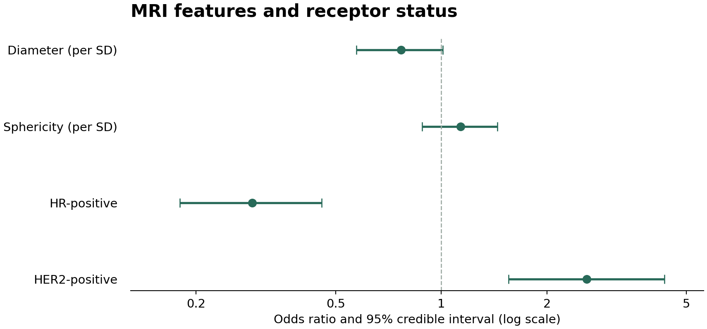

```{r setup, include=FALSE}
knitr::opts_chunk$set(echo = FALSE, message = FALSE, warning = FALSE)
reference <- "../results/reference"
or <- read.csv(file.path(reference, "posterior_odds_ratios.csv"))
loo <- read.csv(file.path(reference, "loo_comparison.csv"))
sensitivity <- read.csv(file.path(reference, "default_prior_odds_ratios.csv"))
```

## Research question

Do baseline MRI tumor longest diameter and sphericity help characterize pathologic
complete response (pCR), and what information do HR and HER2 status add?
This course project uses Bayesian logistic regression to estimate associations
and quantify uncertainty in a complete-case subset of the I-SPY2 imaging cohort.

**Result provenance:** This report presents recorded results from the
[archived PDF](source-course-report.pdf). It does not fit models or claim a new
reproduction. The analysis script is in `scripts/run_analysis.R`.

## Data and models

The original report joined clinical and MRI-feature tables by patient identifiers,
then retained 384 observations complete for pCR, diameter, sphericity, HR and HER2.
A new Python audit of the supplied workbooks confirmed 985 clinical records,
384 MRI records and the same 384 complete cases; it did not refit the models.
Continuous predictors were standardized using complete-case means and SDs.
HR and HER2 were coded as negative (0) or positive (1).

Three Bernoulli-logit specifications were compared: imaging only, imaging plus
additive HR/HER2 terms, and imaging plus HR/HER2 and their interaction.
Priors were Normal(0, 1.5) for the brms intercept, Normal(0, 0.7) for standardized
imaging coefficients, and Normal(0, 1) for receptor and interaction coefficients.
Each fit used four chains, 4,000 iterations per chain, 2,000 warmup and seed 123.

## Posterior associations

```{r posterior-table}
display <- data.frame(Predictor = or$label,
  `Odds ratio` = sprintf("%.2f", or$odds_ratio),
  `95% credible interval` = sprintf("%.2f to %.2f", or$lower_95, or$upper_95),
  check.names = FALSE)
knitr::kable(display)
```

```{r forest, out.width="100%"}

```

HR-positive status was associated with lower odds of pCR and HER2-positive status
with higher odds, conditional on the included predictors. The intervals for
diameter and sphericity overlapped 1. These are associations, not treatment effects.
Point estimates follow the original exp(mean log-odds coefficient) convention.

## Model comparison

```{r loo-table}
knitr::kable(data.frame(Model = loo$label, `ELPD difference` = loo$elpd_diff,
  `SE of difference` = loo$se_diff, check.names = FALSE))
```

The additive model ranked highest in the recorded LOO comparison. The interaction
model had a similar score and added complexity. Imaging alone scored lower.
These are internal comparisons; independent external validation was not performed.

## Diagnostics and sensitivity

The archived additive-model summary reported R-hat values of 1.00 and large
effective sample sizes. Trace plots and a posterior predictive plot appear in
the original PDF. Full original draws and Pareto-k output were unavailable for
independent review; the PDF also contains compiler messages alongside later
sampling results. A clean original execution is not assumed.

```{r sensitivity-table}
knitr::kable(data.frame(Predictor = or$label,
  `Specified-prior OR` = round(or$odds_ratio, 2),
  `Default-prior OR` = round(sensitivity$odds_ratio, 2), check.names = FALSE))
```

The default-prior refit retained similar coefficient directions and broadly similar
magnitudes. This is one sensitivity check, not a general guarantee of robustness.

## Limitations and reproducibility

The analysis used complete cases, a small feature set and no external validation.
Treatment arm was not included as a covariate. The reported LOO analysis preserved
global standardization rather than refitting all preprocessing inside each fold.
Neither clinical utility nor causal effects were established.

The original editable file was unavailable. R code was reconstructed from the PDF;
raw data and fitted-model objects are not bundled. The reconstructed pipeline has
not been rerun with R/Stan and the original data. New results, when generated, are
saved separately under `results/rerun/` and require diagnostic review.

## Sources

- [Author's original course report](source-course-report.pdf), March 2026.
- [TCIA I-SPY2 collection](https://www.cancerimagingarchive.net/collection/ispy2/).
- [brms documentation](https://paulbuerkner.com/brms/).
